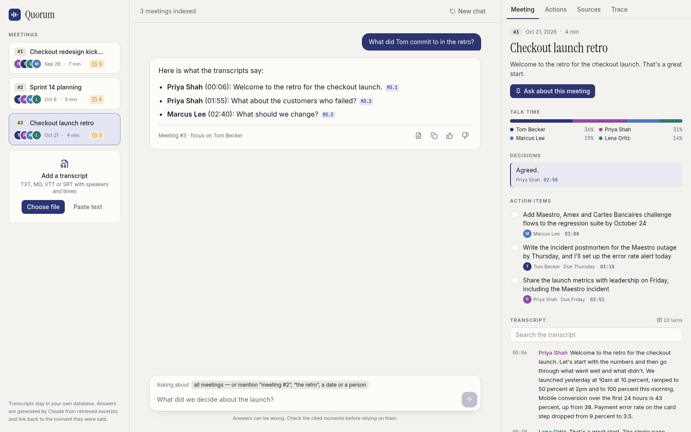
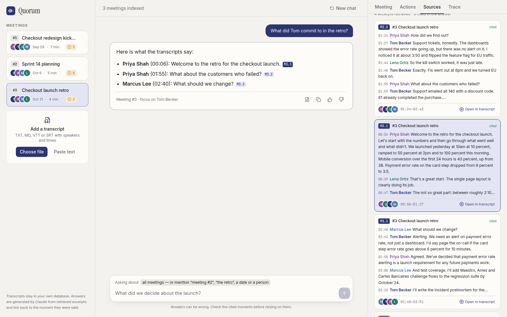
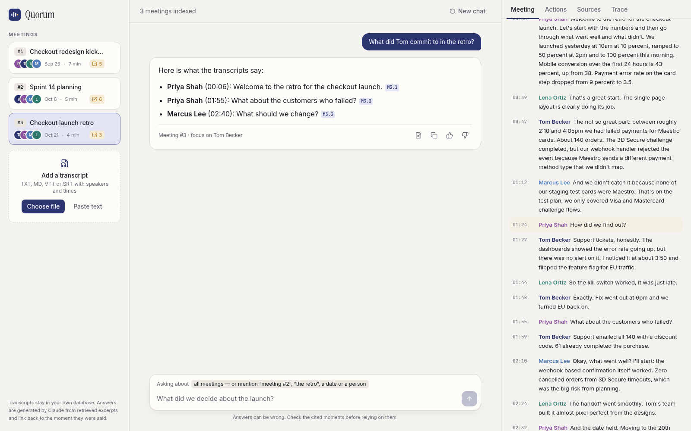
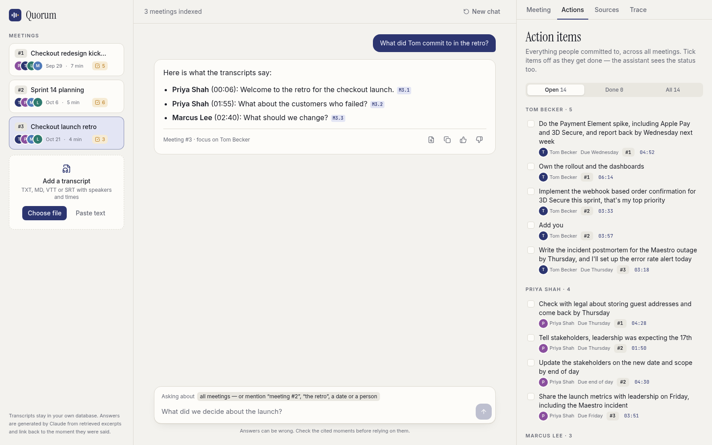
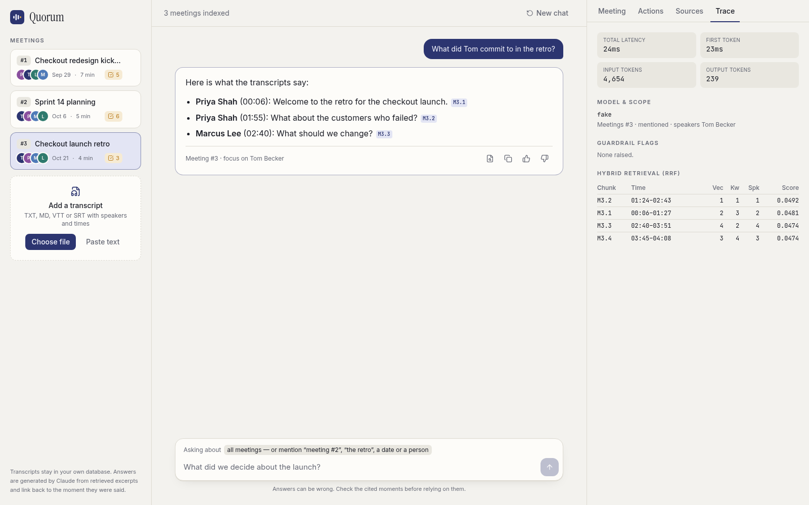
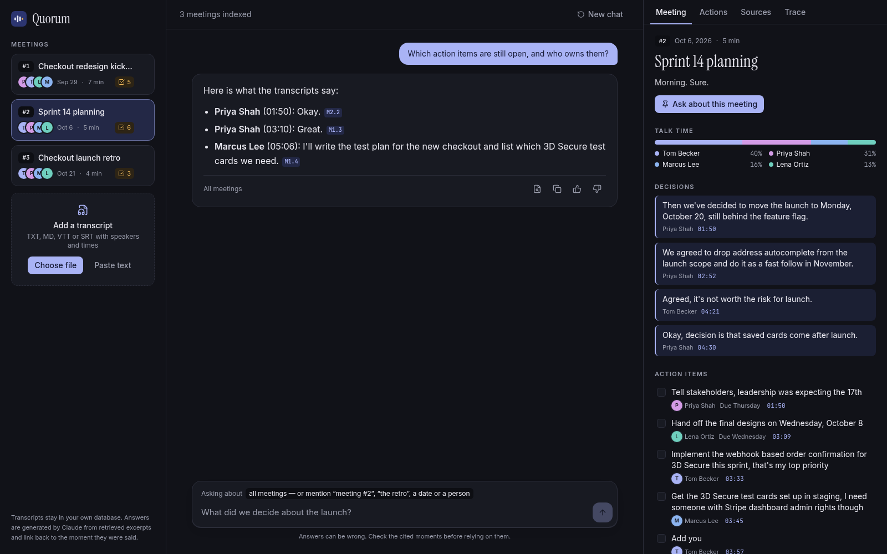
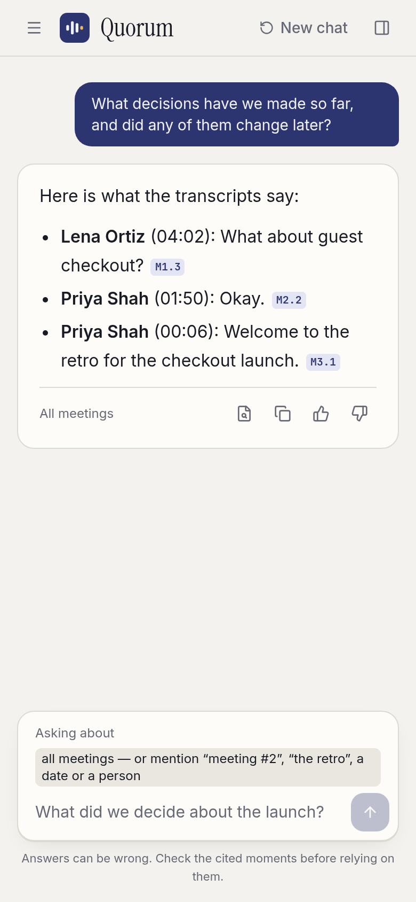
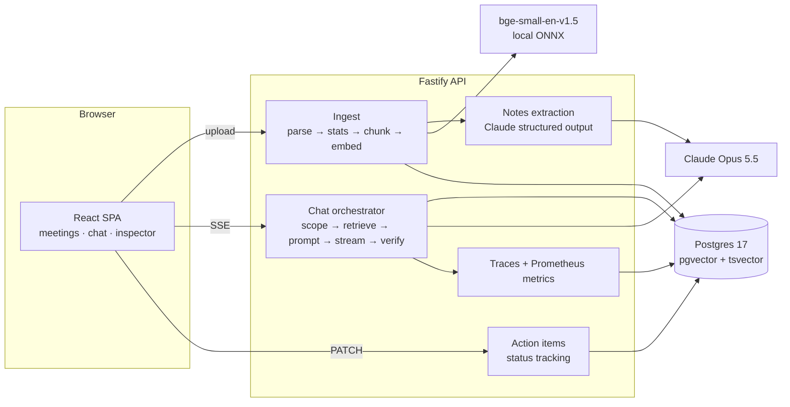

# Quorum — meeting intelligence

Upload meeting transcripts and Quorum turns them into something you can query. It pulls out decisions, action items and open questions, shows who spoke how much, and answers questions like _"Why did the launch move from October 17?"_ or _"What did Lena commit to in meeting #2?"_. Every answer cites the transcript excerpts it used, and each citation opens the transcript at the moment it was said.



| Sources behind an answer                 | Jump to the moment                             | Action items across meetings             |
| ---------------------------------------- | ---------------------------------------------- | ---------------------------------------- |
|  |  |  |

| Retrieval trace                      | Dark                               | Mobile                                 |
| ------------------------------------ | ---------------------------------- | -------------------------------------- |
|  |  |  |

> The screenshots were taken with `LLM_PROVIDER=fake` so anyone can reproduce them without an API key. Parsing, talk time, retrieval, scoping and the citation checks are real. The answer text and the extracted notes come from the fake model, which is why they read a bit mechanically.

---

## Quick start

You need Docker and an Anthropic API key.

```bash
cp .env.example .env            # put your ANTHROPIC_API_KEY in it
docker compose --env-file .env up --build
open http://localhost:8080
```

Then upload the three transcripts in `samples/meetings/`. They are one project told across three meetings (kickoff, sprint planning, launch retro), in three formats (`.txt`, `.vtt`, `.md`), and one decision gets changed along the way. That makes them good for questions that cross meetings.

The first upload takes a few seconds longer because the API downloads the embedding model (about 35 MB, cached in a Docker volume).

### Local development

```bash
pnpm install
pnpm db:up                      # Postgres 17 + pgvector on :5432 (DB_PORT=... to change)
pnpm dev                        # api on :3000, web on :5173 (proxies /api)
```

| Command                                            | What it does                                                                                      |
| -------------------------------------------------- | ------------------------------------------------------------------------------------------------- |
| `pnpm test`                                        | API unit and integration tests (in-memory PGlite with pgvector, fake LLM) and web component tests |
| `pnpm eval`                                        | Runs the eval set in `apps/api/eval` against `samples/meetings`                                   |
| `pnpm typecheck && pnpm lint && pnpm format:check` | What CI runs                                                                                      |

No API key? Set `LLM_PROVIDER=fake` to run the whole app end to end with a deterministic stand-in model.

### Transcript formats

Transcripts need speaker labels and timestamps. The parser accepts:

```
[00:01:23] Priya Shah: We go with Payment Element.      bracketed, h:mm:ss or mm:ss
00:01:23 - Priya Shah: …                                 bare timestamp
Priya Shah (01:23): …   /   Priya Shah [01:23]: …        speaker first
Priya Shah 1:23                                          Otter / Zoom export style,
We go with Payment Element.                              text on the next line
WEBVTT cues with <v Priya Shah> voice tags or "Priya Shah: …"
SRT cues with "Priya Shah: …"
```

Lines without a header are joined onto the previous turn. Anything before the first turn (title, date, attendees) is kept as a preamble and given to the extraction step. Consecutive cues from the same speaker less than 30 seconds apart are merged into one turn.

---

## Architecture



**What happens when you upload a transcript**

1. **Parse.** The file is read as text and parsed into turns: `{start, speaker, text}`. A file that doesn't produce at least two timestamped, speaker-labelled turns is rejected with a message that shows the expected format.
2. **Stats.** Talk time (share of words), turn counts and duration are computed in code.
3. **Extract.** Claude reads the whole transcript once and returns typed meeting notes, checked against a Zod schema: title, date, summary, topics, decisions, action items (owner, task, due) and open questions. Each item carries the second it was said. Timestamps are clamped to the meeting length and dates are validated before saving.
4. **Chunk.** Turns are grouped into chunks of up to about 1,000 characters. A turn is never split unless it is longer than a chunk on its own, and the last short turn of a chunk is repeated at the start of the next one.
5. **Embed and store.** Each chunk is embedded with the meeting title and time range in front, then stored with its time range, its speakers (`text[]`, GIN index) and a generated `tsvector`. Action items go into their own table so their status can change.

**What happens when you ask a question**

1. **Scope.** Work out which meetings the question is about. A pinned meeting in the UI wins. Otherwise look for "meeting #2", "meetings 1 and 3", "the last call", a date ("October 6", "2026-10-06"), a full title, or a meeting kind ("the retro", "the kickoff") that matches exactly one title. If nothing matches, use all meetings. People named in the question ("What did Lena…") are resolved against the known speakers.
2. **Retrieve.** Run three ranked lists over the scoped meetings: pgvector cosine search, Postgres full-text search, and vector search restricted to chunks where a mentioned person speaks. Merge them with Reciprocal Rank Fusion, cap chunks per meeting (10 for one meeting, 5 for up to three, 3 beyond that), and stay within a character budget.
3. **Context.** For each scoped meeting, add its notes: summary, talk time, decisions and action items **with their current open/done status**. Then add the excerpts in time order, each tagged with a stable id, `M2.3` for chunk 3 of meeting #2, plus its time range and speakers.
4. **Generate.** Stream Claude's answer to the browser over SSE.
5. **Verify.** Check every `[M#.#]` citation against the excerpts that were actually retrieved. Then check every attribution the answer makes in the form `Name (mm:ss)`: there must be a line by that speaker within 45 seconds of that time in the excerpts. Failures are flagged in the UI and stored on the trace.

**Repo layout**

```
apps/api      Fastify service (src/{ingest,meetings,retrieval,chat,llm,embeddings,routes,db})
apps/api/eval Eval dataset + runner
apps/web      React SPA
samples/      Demo meeting transcripts
```

---

## RAG / LLM decisions

### LLM — Claude Opus 5.5

- **Considered:** Claude Sonnet 5.5, Haiku 5.5, GPT-class models, a local Llama.
- **Chose Opus 5.5.** Chat runs at `effort: medium`, extraction at `effort: low`.
  - The hard part of this problem is telling a proposal from a decision and noticing when a later meeting overrides an earlier one. That is reasoning, not lookup, and it is where weaker models slip.
  - Extraction runs once per transcript, so its cost is paid once and not per question.
  - The model is an env var (`LLM_MODEL`). Moving extraction to Sonnet or Haiku is a one-line change once the eval shows quality holds.
- **Structured outputs.** Extraction uses `messages.parse` with a Zod schema, so notes always come back valid and typed. There is no JSON-repair code.
- **Refusal fallback.** Server-side refusal fallback is on, so a request a safety classifier declines is retried on a fallback model instead of failing.
- **Prompt caching.** The answer system prompt is marked for caching.

### Embeddings — `bge-small-en-v1.5`, run locally via transformers.js (ONNX, q8)

- **Considered:** Voyage / OpenAI embeddings (hosted, better quality), `all-MiniLM-L6-v2`.
- **Why local:** no second API key, meeting content never leaves the box except for the Claude call, fast enough on CPU, and better retrieval than MiniLM at the same 384 dimensions.
- **Downside:** spoken language is messy and short turns ("Agreed.", "None from me.") embed poorly on their own. That is one reason chunks are groups of turns and not single turns.
- The `Embedder` interface makes a hosted model a single new class.

### Vector DB — Postgres + pgvector

- **Considered:** Qdrant, Pinecone, Chroma.
- **Why Postgres:** the data is small and relational (meeting → chunks, meeting → action items, traces). One database gives vectors, full-text search, array filters for speakers, transactions, cascading deletes and JSONB for notes.
- **Tests** run against PGlite, which is real Postgres compiled to WASM with pgvector. The SQL under test is the SQL that runs in production, and no Docker is needed.
- **Indexes:** HNSW on cosine distance, GIN on `tsvector` and on `speakers`.

### Orchestration — no framework

- **Considered:** LangChain, LlamaIndex.
- **Why plain code:** the pipeline is five explicit steps. Plain TypeScript keeps every prompt, ranking decision and token visible and unit-testable. A framework would add a layer without removing any real complexity here.

### Chunking — by speaker turns

- A transcript has no headings, but it has two strong structures: turns and time. Chunks follow turns, so an excerpt never starts mid-sentence and a citation always maps to a clean time range.
- Turns are packed into chunks up to ~1,000 characters. Repeating the last short turn of a chunk at the start of the next keeps question-and-answer pairs together ("Any objections?" / "None from me.").
- Each chunk keeps `startSec`, `endSec` and its speakers. That metadata drives the speaker filter, the timestamps shown in the UI and the "Open in transcript" jump.
- **Considered and skipped for now:** topic segmentation with the LLM (better boundaries, but another LLM call per transcript and harder to test), and fixed time windows (simple, but they cut through turns).

### Retrieval

- **Hybrid search with RRF.** Meetings are full of exact tokens that matter, like "Maestro", "3DS", "sprint 16" or a date. Keyword search catches those reliably where vectors sometimes don't, and vectors handle paraphrase ("we pushed the date" ↔ "move the launch").
- **Speaker list.** When a question names a person, a third ranked list of chunks where that person speaks is fused in. It boosts their turns without throwing away context from others, which matters for "What did Tom agree to?" where the ask often comes from someone else.
- **Per-meeting caps** stop one long meeting from crowding out the others in cross-meeting questions.

### Deterministic vs LLM

- **Code:** parsing, timestamps, talk time, chunking, scope resolution, retrieval, action item status, citation and attribution checks. All of it is reproducible and unit-tested.
- **LLM:** reading a whole transcript into notes, and writing answers.
- The notes are generated once and stored, so the "Meeting" tab, the action item board and the prompt all agree with each other. The user can tick action items off, and the next answer sees the new status.

### Prompt and context management

- **Stable system prompt.** Citation format, "proposal vs decision", "say when a later meeting changed an earlier decision", the scope limits and the injection policy. It never changes, so it caches well.
- **Per-turn context.** Context goes into the latest user message only. History keeps the last 6 turns, each cut to 2,000 characters, and old turns don't carry their context. The token count stays flat over a long conversation.
- **Notes shrink with scope.** With more than four meetings in scope, each meeting's notes are cut to summary and talk time and the excerpts carry the detail.
- **Source format.** `<source id="M2.3" meeting="Meeting #2 (Sprint 14 planning, 2026-10-06)" time="01:50–02:52" speakers="…">`. Tag-like text inside transcripts is stripped first.

### Guardrails

| Risk                            | Mitigation                                                                                                                                                                                                              |
| ------------------------------- | ----------------------------------------------------------------------------------------------------------------------------------------------------------------------------------------------------------------------- |
| Prompt injection in transcripts | Transcripts are wrapped in tags, and tag-like text inside them is stripped. The system prompt says sources are data and the model must mention it if a transcript contained instructions. Extraction has the same rule. |
| Prompt injection in questions   | A pattern detector flags these and stores the flag on the trace. Not blocked, because false positives would hurt more.                                                                                                  |
| Hallucinated sources            | Every `[M#.#]` citation is checked against what was retrieved. Unknown ones are struck through in the UI with a warning. Answers without citations are flagged.                                                         |
| Misattributed quotes            | Every `Name (mm:ss)` in an answer is checked against the speaker and time of the retrieved lines (±45 s). Misses are flagged as `unverified_attribution`.                                                               |
| Wrong meeting referenced        | Asking about "meeting #7" when there are three raises `unknown_meeting_reference` and the UI says so.                                                                                                                   |
| Garbage input                   | Files without timestamped speaker turns are rejected with the expected format. Unsupported extensions are rejected.                                                                                                     |
| Abuse / cost                    | 2,000-character question limit, 2 MB upload limit, 200k-character transcript limit, Zod validation on every route.                                                                                                      |

### Quality

- **Unit tests** cover the deterministic core: every transcript format, timestamps, talk time, chunking and overlap, scope (numbers, ordinals, dates, meeting kinds, speakers), RRF, context rendering, citation and attribution checks.
- **Integration tests** cover the full HTTP flow on PGlite: upload (multipart and JSON, TXT and VTT) → numbering → notes → action item status → SSE chat → trace → feedback → delete with cascade.
- **Eval harness** (`pnpm eval`) runs 12 labelled questions over `samples/meetings`. It reports scope accuracy, source recall, MRR of the first expected excerpt, guardrail flag accuracy, citation validity and attribution validity. With a key set, it also reports a must-mention rate for the answer text.
  - Baseline with local embeddings: scope 1.0, recall 1.0, MRR 0.40.
  - Recall is trivially high because the sample corpus is only 13 chunks. MRR is the number to improve. The weakest case is "When is the checkout launch date?": every chunk mentions the launch, and the one that sets the date ranks low.
- **User feedback.** Thumbs up/down on an answer is stored on its trace, so bad answers can be pulled into the eval set.

### Observability

- **Logs:** structured pino logs with a request id, echoed in `x-request-id`.
- **Prometheus `/metrics`:** HTTP latency, time to first token, retrieval latency, ingestion time, extracted decisions and action items, LLM tokens in/out, chat outcomes and guardrail flags by type.
- **Trace per answer** (`traces` table, shown in the **Trace** tab): question, resolved scope and speakers, each retrieved chunk with its vector, keyword and speaker rank and RRF score, flags, model, latency, first-token latency, token counts and user feedback.
- **Health:** `/health` (liveness) and `/ready` (checks the DB).

---

## Key technical decisions

1. **Extract once, query many times.** Notes are extracted when a transcript is uploaded and stored. The Meeting tab, the action item board and every prompt read the same data, so they never disagree, and the expensive full-transcript read happens once.
2. **Citations point at time, not just text.** Chunks carry time ranges and speakers, so every citation can open the transcript at the right line. In a meeting tool "where did we say that?" is the main way people build trust in an answer.
3. **Action items are state, not text.** They live in their own table with a status. Ticking one off changes what the assistant says is still open.
4. **Meetings get stable numbers** (`#1`, `#2`…). "Meeting #2" means the same thing in the UI, the prompt, citations and traces.
5. **SSE over WebSockets.** Data only flows one way. SSE works through nginx and load balancers with `proxy_buffering off`, and it's easy to test with `inject()`.
6. **Fastify + Zod + Drizzle.** Typed end to end, small and fast to boot. Drizzle keeps SQL visible; hybrid search is three readable queries.
7. **Dependencies are injected at the app factory.** `buildApp({ db, llm, embedder })` makes the full HTTP stack testable with fakes in milliseconds.
8. **Hand-written SQL migrations** with a ~20-line runner. The same migration runs on Postgres and PGlite.

---

## Productionizing and scaling

What I'd change to run this for real teams, on AWS as the example (GCP and Azure have direct equivalents):

- **Tenancy and auth.** Add organisations, users and SSO (Cognito or an IdP via OIDC). Every table gets an `org_id`, enforced with Postgres row-level security so a missing `where` can't leak another team's meetings.
- **Async ingestion.** Today upload is synchronous; a 90-minute meeting would take too long. Put files in S3, enqueue a job (SQS), and run parse → extract → embed in workers. The UI polls or subscribes for status. Retries and a dead-letter queue handle Claude or embedding failures.
- **Compute.** API and web on ECS Fargate (or Cloud Run) behind an ALB with sticky-free SSE and long idle timeouts. Workers scale on queue depth. The web build moves to S3 + CloudFront.
- **Database.** RDS / Aurora Postgres with pgvector. At millions of chunks: partition by org, tune HNSW, and consider a dedicated vector store only if Postgres stops keeping up.
- **Embeddings.** Move to a hosted embedding model (Bedrock / Voyage) or a GPU endpoint so workers don't each load ONNX on CPU.
- **Voice.** Accept audio, transcribe with diarization (a managed speech-to-text service or WhisperX), and feed the result into the same parser. The parser already accepts VTT/SRT, which is what most of these services emit.
- **Integrations.** Pull transcripts from Zoom / Google Meet / Teams webhooks instead of manual upload; push action items to Jira / Linear.
- **Security and compliance.** KMS encryption at rest, retention policies per org, PII redaction before indexing where needed, audit log of who read which meeting.
- **Observability.** Ship logs to CloudWatch or Datadog, scrape `/metrics` with Managed Prometheus, add OpenTelemetry tracing across API → worker → Claude, and alert on first-token latency, error rate and guardrail flag rate.
- **CI/CD.** The existing CI (lint, typecheck, tests, docker build) plus image push to ECR, IaC with Terraform or CDK, migrations as a deploy step, and the eval as a quality gate on prompt or model changes.
- **Cost.** Extraction is the largest per-meeting cost; route it to a cheaper model when the eval allows, batch it, and cache the system prompt.

---

## Engineering standards

**Followed**

- Strict TypeScript everywhere (`noUncheckedIndexedAccess`, `verbatimModuleSyntax`), Zod at every boundary (env, HTTP, LLM output).
- ESLint + Prettier, enforced in CI. Conventional commits.
- Small modules with one job each; the deterministic core has no I/O and is unit-tested directly.
- Fakes behind interfaces instead of mocks: `FakeLlm` and `FakeEmbedder` let the full stack run in tests and locally without keys.
- Multi-stage Docker builds, non-root runtime user, health checks.
- No code comments by choice; names carry the meaning, and the README carries the reasoning.

**Skipped, on purpose**

- No auth or multi-tenancy (single team, local deployment).
- No E2E browser tests in CI; component tests and API integration tests cover most of the risk for now.
- Synchronous ingestion (fine for transcripts of a few thousand turns, not for production).
- Meeting numbers are `max + 1`, so deleting the newest meeting frees its number for the next upload.

---

## How I used AI tools

<!-- Replace with your own account. Facts that are true about this repo are below; the opinions are yours to write. -->

- The project reuses the architecture, tooling and conventions of my previous assignment (career-intel), which I had already reviewed and decided on. `CLAUDE.md` records those rules so an assistant follows them: no comments, fakes instead of real APIs in tests, deterministic code for anything that must be repeatable, conventional commits.
- I used Claude Code to implement the meeting-specific parts against those rules: the transcript parser, turn-based chunking, scope resolution, the speaker-aware retrieval, the attribution check and the UI.
- Guardrails I rely on to keep generated code honest: typecheck, lint and tests must pass before each commit, and the eval has to stay green when retrieval or prompts change.

---

## What I'd do with more time

- **Voice-to-transcript** with diarization, feeding the existing parser.
- **Better ranking.** A cross-encoder reranker over the fused list, and a recency prior for "what is the current plan?" questions so the latest meeting wins over the kickoff.
- **Decision lineage.** Link decisions across meetings ("launch Oct 17" → superseded by "launch Oct 20") as data, not only as an instruction in the prompt.
- **Evaluate extraction** with a labelled set of decisions and action items per sample meeting (precision/recall), not just answers.
- **Bigger eval corpus** with real, noisy transcripts (crosstalk, ASR errors, unlabelled speakers) so recall stops being trivially 1.0.
- **Speaker aliases** ("Tom" vs "Thomas Becker" vs "SPEAKER_02") resolved per org.
- **Async ingestion with progress**, and delete-safe meeting numbers.
- **E2E tests** with Playwright for the upload → ask → open-in-transcript flow.
